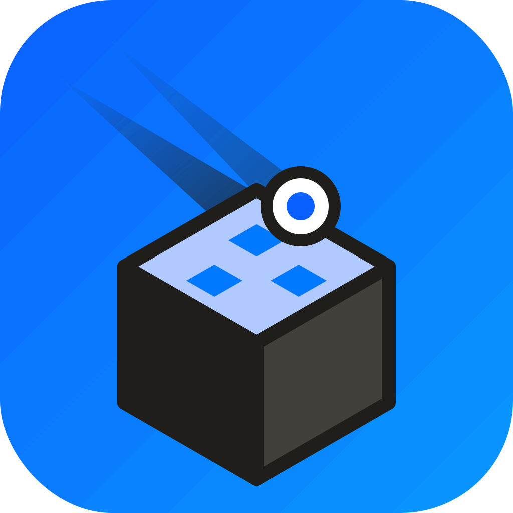
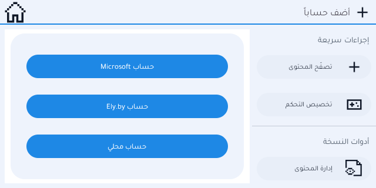

  

<h1 align="center">BlockComet Launcher</h1>

  A Minecraft: Java Edition launcher for Android with ready-to-play Fabric instances, a full Arabic interface and deep
  customization. 
  <a href="README.ar.md">العربية</a> · <a href="docs/CUSTOMIZING.md">Customizing</a> · <a href="docs/BUILDING.md">Building</a> ·
  <a href="docs/ARCHITECTURE.md">How it works</a> · <a href="CHANGELOG.md">Changelog</a>

> **Not affiliated with Mojang or Microsoft.** Minecraft is not included. You need a Minecraft: Java Edition account that
> owns the game. Free software, LGPL-3.0, built on [Copper Launcher](https://github.com/CopperLauncher/Copper-Android).

## Download

| | |
|---|---|
| Stable release | [`BlockComet.apk`](https://github.com/justaguyLV/effectcraft/releases/latest/download/BlockComet.apk) (appears after the first `v*` release) |
| Latest build of the main branch | [`BlockComet.apk`](https://github.com/justaguyLV/effectcraft/releases/download/copper-latest/BlockComet.apk) |
| All releases | https://github.com/justaguyLV/effectcraft/releases |

Android 6.0 (API 23) or newer. Install the APK (allow "install from this source" for your browser or file manager), open
the launcher, sign in with your Microsoft account, pick an instance from the bar at the bottom and press **Play**.

Every release also lists `THIRD_PARTY_NOTICES.txt`; the same text is inside the app under **About → Licenses**.

## What is in it

**Ready-to-play instances.** On first start the launcher creates one "Meteor *version*" instance for each of
Minecraft 1.20.1, 1.20.2, 1.20.4, 1.20.6, 1.21.1 and the newest versions the build could prepare. Each one has the
newest stable Fabric Loader, Fabric API, [Meteor Client](https://github.com/MeteorDevelopment/meteor-client) and the
performance mods that exist for that version: FerriteCore, Lithium, ModernFix, Krypton, Noisium, MemoryLeakFix and
ScalableLux. Which mod is in which instance is listed in **About → Licenses**.

**Customization** (Settings → Launcher appearance):

* **Color Studio**: ten colors entered as exact hex / RGB values, six presets, live preview.
  Exact colors need Android 11+; older versions use the closest ready palette.
* **Background and surfaces** (white, soft gray, graphite, pure black), **corner roundness**, **20 preset fonts** and
  **import of any `.ttf` / `.otf` file** as the launcher font.
* **Share my look**: exports your colors, font, language and background image or video into one file; a friend imports it
  and gets the same look.
* A custom launcher background (image, GIF or video), animations, forced landscape.

**Languages.** 46 languages selectable in the app, and a complete right-to-left Arabic interface (Tajawal font so that
Arabic and Latin text share one design).

**Fixes on top of Copper.** The hotbar touch area now matches the real hotbar (182 × 22 GUI pixels), with an optional
red overlay (Settings → Launcher appearance → "Show the hotbar touch area") to see where taps land.

**An in-app "About" page** replaces the old web link, with the source-code address, the licenses and a Discord button.

## Screenshot

## Status and limits

* Built and checked in an Android 11 x86_64 emulator on GitHub Actions (launch, screens, Arabic layout).
  It has **not** been tested on a wide range of real devices. Please open an issue with your device and Android version if
  something looks wrong.
* Meteor Client is a utility ("hacked") client. Many multiplayer servers forbid it. You are responsible for where you use it.
  Its own menus are in English.
* Sodium is deliberately not bundled: it needs more OpenGL than many phones offer. You can add it from *Browse Content*.
* The launcher cannot make a copy of Minecraft run without a licensed account, and nothing here helps with that.

## Building

The repository holds a **recipe**, not a copy of Copper's source: the workflow downloads Copper at a pinned commit, applies
the BlockComet scripts, builds the APK on GitHub Actions and publishes it. See [docs/BUILDING.md](docs/BUILDING.md) to build
your own, sign it with your key, or update the pinned version, and [docs/ARCHITECTURE.md](docs/ARCHITECTURE.md) for what each
script changes.

## License and credits

BlockComet Launcher is free software under the **GNU LGPL v3** ([LICENSE](LICENSE), [COPYING](COPYING)). The source you need
to rebuild the app is this repository plus the pinned upstream commit named in the workflow.
Built on [Copper Launcher](https://github.com/CopperLauncher/Copper-Android),
[MojoLauncher](https://github.com/MojoLauncher/MojoLauncher) and
[PojavLauncher](https://github.com/PojavLauncherTeam/PojavLauncher), with
[Meteor Client](https://github.com/MeteorDevelopment/meteor-client) (GPL-3.0), [Fabric](https://fabricmc.net) and the mods
listed in [NOTICE.md](NOTICE.md). Fonts are from [Google Fonts](https://github.com/google/fonts) (SIL OFL 1.1; Ubuntu under
its own licence).

## Community

Discord: https://discord.gg/5fhcfW2Ge · Bugs and ideas: [issues](https://github.com/justaguyLV/effectcraft/issues) ·
How to help: [CONTRIBUTING.md](CONTRIBUTING.md) · Security: [SECURITY.md](SECURITY.md)
